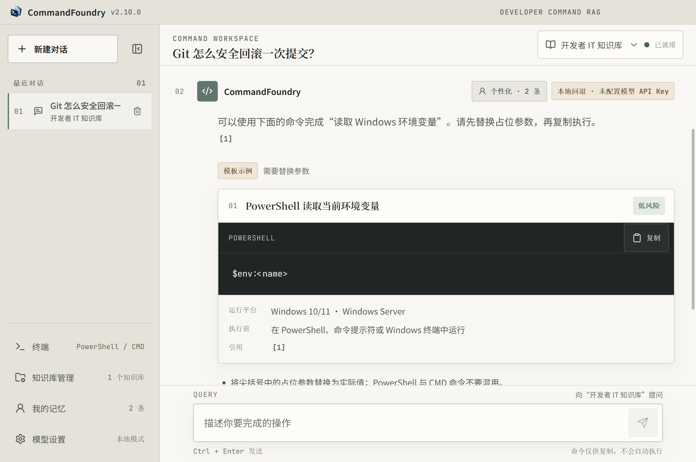
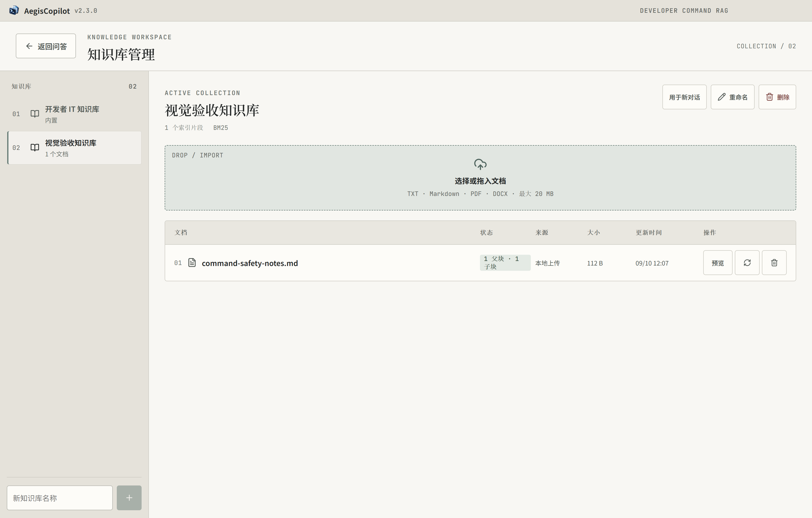
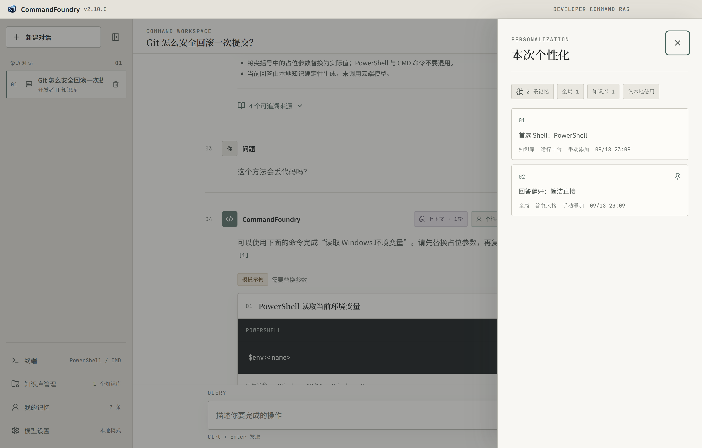

# CommandFoundry

CommandFoundry is a local-first command RAG desktop application for developers, currently focused on Windows.

## What it does

- Turns natural-language operations into source-grounded, copyable commands; asks for required details such as paths, shells, and ports when they are missing.
- Searches local knowledge with parent/child chunk retrieval and precise citations. It supports TXT, Markdown, PDF, and DOCX uploads, as well as multiple knowledge bases.
- Covers common PowerShell, CMD, and POSIX developer operations, including Python, Git, Docker, and Windows file, process, service, and networking topics.
- Uses the official OpenAI SDKs to connect to DeepSeek, OpenAI, Qwen, Moonshot, SiliconFlow, Ollama, and other OpenAI-compatible APIs.
- Provides local retrieval, personalized context, resumable command-parameter planning, and a side terminal. Local commands are run only after explicit user confirmation.

## Troubleshooting agent (experimental)

`backend/app/troubleshoot` is a developer troubleshooting agent. It uses tools to find and fix service faults, write actions go through a host policy and approval, and host probes decide whether a fix worked. It is not part of the desktop app yet; it runs in an isolated sandbox through `scripts/run_memory_bench.py`.

- Long-term memory: only runs the host verified add project facts and fixes. Failed attempts are kept as negative experience, and fixes that keep failing are quarantined. Memory only informs the model and cannot relax the safety policy.
- Trajectory distillation: Qwen3.5-4B is LoRA-tuned on troubleshooting trajectories from a teacher model.

Task success rates below use apps and fault types absent from training, 100 sessions per cell, temperature 0.7, skills off:

| Model | No memory | With memory |
| --- | --- | --- |
| Qwen3.5-4B base | 75% | 92% |
| Qwen3.5-4B distilled | 91% | 92% |
| Qwen3.5-9B base (FP8) | 96% | 93% |

The scenarios are built by this project and cover 2 apps; repeating one configuration can differ by about 6 points. Methods, confidence intervals and known issues are in [AGENT_EVOLUTION.md](docs/AGENT_EVOLUTION.md) (Chinese).

## Technology stack

| Layer | Technology |
| --- | --- |
| Desktop | Electron, electron-builder / NSIS, Node.js |
| Frontend | React, Vite, Lucide React |
| Backend | Python, FastAPI, Pydantic, SQLite, SSE |
| Retrieval | BM25, FastEmbed, ONNX Runtime, RRF |
| Model APIs | Official OpenAI Python/Node SDKs, OpenAI-compatible APIs |
| Packaging | PyInstaller, Windows x64 NSIS |

## Screenshots

### Command workspace

### Knowledge-base management

### Personalized context

中文版本：[README.md](README.md)
