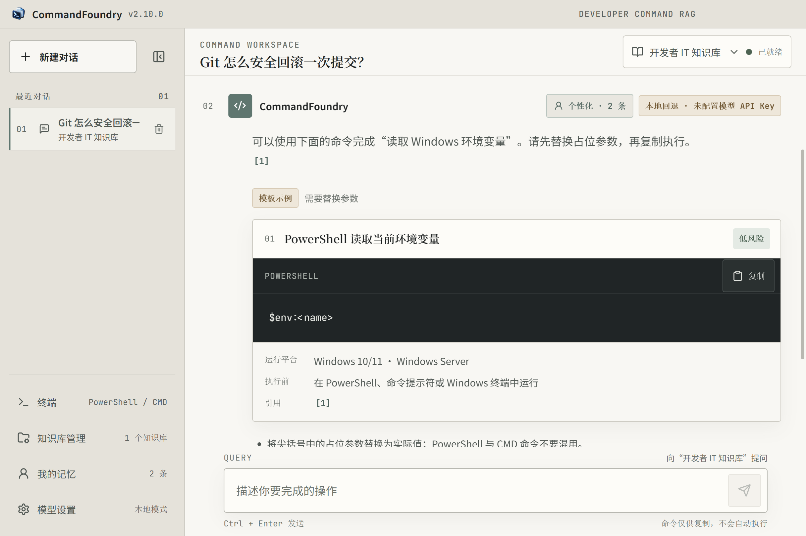
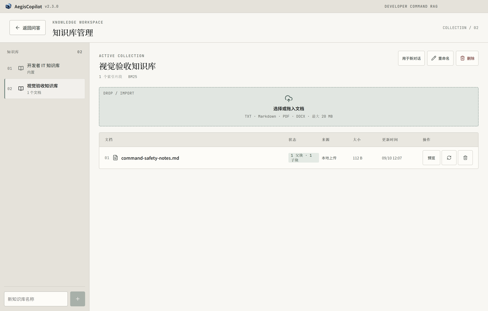
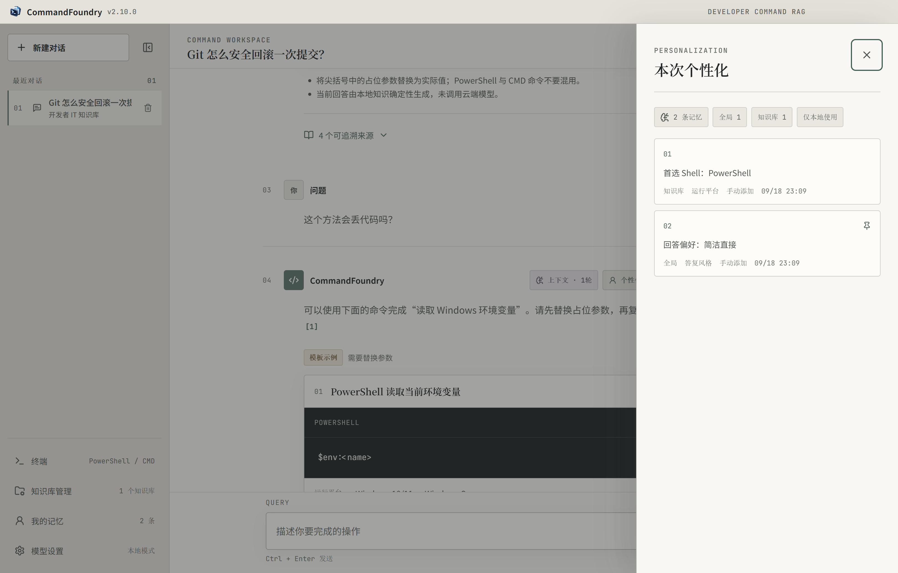

# CommandFoundry

CommandFoundry 是面向开发者的本地优先命令 RAG 桌面应用，当前主要面向 Windows。

## 能完成什么

- 将自然语言操作转换为带来源、可复制的命令；信息不足时逐项询问路径、Shell、端口等必要参数。
- 使用本地知识库进行父子块检索和精确引用，支持上传 TXT、Markdown、PDF、DOCX，并可管理多个知识库。
- 覆盖 PowerShell、CMD 和 POSIX 常用开发者操作，包括 Python、Git、Docker、Windows 文件/进程/服务/网络等主题。
- 通过官方 OpenAI SDK 接入 DeepSeek、OpenAI、通义千问、Moonshot、SiliconFlow、Ollama 及其他 OpenAI 兼容 API。
- 支持本地检索、个性化上下文和可恢复的命令参数规划；提供侧边终端，只有用户明确确认后才执行本机命令。

## 排障 Agent（实验中）

`backend/app/troubleshoot` 是一个开发者排障 Agent：它用工具定位并修复服务故障，写操作要经过主机策略和审批，是否修好由主机探针判定。它还没有接入桌面应用，目前在隔离沙箱里通过 `scripts/run_memory_bench.py` 运行和评测。

- 长期记忆：只有主机验证通过的运行才会沉淀项目事实和修复经验，失败的尝试记为负面经验，反复失败的经验会被隔离。记忆只作参考，不能放宽安全策略。
- 轨迹蒸馏：用教师模型的排障轨迹对 Qwen3.5-4B 做 LoRA 微调。

下表是任务成功率。评测使用训练中未出现的应用和故障类型，每格 100 个会话，温度 0.7，Skill 关闭：

| 模型 | 无记忆 | 有记忆 |
| --- | --- | --- |
| Qwen3.5-4B 原版 | 75% | 92% |
| Qwen3.5-4B 蒸馏后 | 91% | 92% |
| Qwen3.5-9B 原版（FP8） | 96% | 93% |

这组场景由项目自己构造，只覆盖 2 个应用；同一配置重跑可能相差 6 个百分点左右。方法、置信区间和已知问题见 [AGENT_EVOLUTION.md](docs/AGENT_EVOLUTION.md)。

## 技术栈

| 层 | 技术 |
| --- | --- |
| 桌面端 | Electron、electron-builder / NSIS、Node.js |
| 前端 | React、Vite、Lucide React |
| 后端 | Python、FastAPI、Pydantic、SQLite、SSE |
| 检索 | BM25、FastEmbed、ONNX Runtime、RRF |
| 模型接口 | 官方 OpenAI Python/Node SDK、OpenAI-compatible API |
| 打包 | PyInstaller、Windows x64 NSIS |

## 软件截图

### 命令工作区

### 知识库管理

### 个性化上下文

English: [README.en.md](README.en.md)
